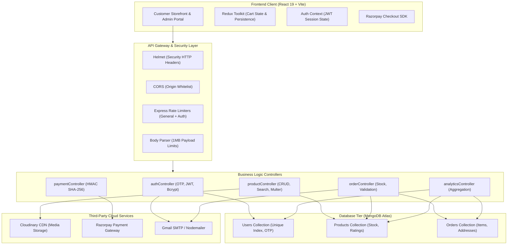
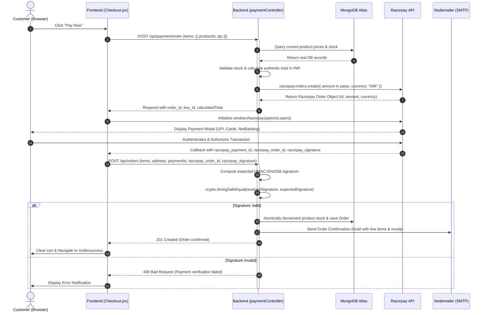
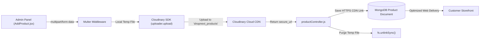
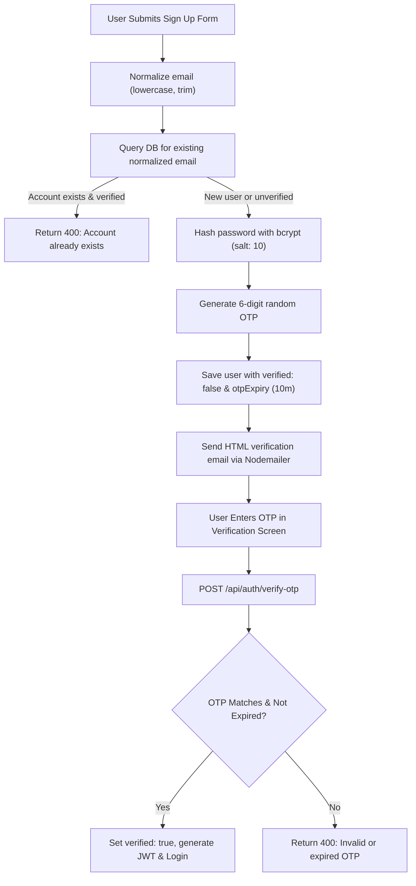
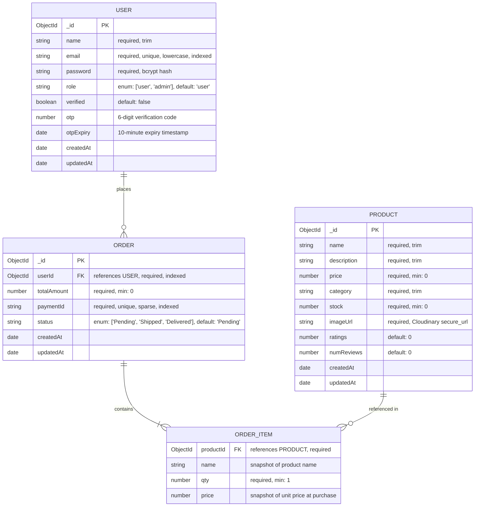

# ShopNext 🛍️ — Enterprise Full-Stack E-Commerce Platform

ShopNext is a modern, production-grade e-commerce application built on the **MERN** stack (MongoDB, Express.js, React 19, Node.js) paired with **Vite**, **Redux Toolkit**, **Cloudinary** asset management, **Razorpay** secure payment gateway, and **Nodemailer** transactional email dispatch.

---

## 📑 Table of Contents
1. [System Architecture & High-Level Design](#-system-architecture--high-level-design)
2. [Core Subsystems & Integration Workflows](#-core-subsystems--integration-workflows)
   - [Razorpay Secure Payment Flow](#1-razorpay-secure-payment-gateway-flow)
   - [Cloudinary Media Upload Pipeline](#2-cloudinary-media-management-pipeline)
   - [Authentication & OTP Verification Flow](#3-authentication--otp-verification-flow)
3. [Project Directory & Folder Structure](#-project-directory--folder-structure)
4. [Database Schemas & Data Models](#-database-schemas--data-models)
5. [Security & Defensive Engineering](#-security--defensive-engineering)
6. [Complete REST API Specification](#-complete-rest-api-specification)
7. [Environment Variables Reference](#-environment-variables-reference)
8. [Getting Started & Local Setup](#-getting-started--local-setup)

---

## 🏛️ System Architecture & High-Level Design

The ShopNext architecture adopts a decoupled client-server model designed for performance, security, and scalability.



---

## 🔄 Core Subsystems & Integration Workflows

### 1. Razorpay Secure Payment Gateway Flow

To prevent client-side price tampering, **all prices and order totals are computed strictly on the server** by re-querying the database using item IDs and quantities before initializing an order with Razorpay.



#### Cryptographic Verification Detail
```javascript
// backend/src/controller/paymentController.js
const sign = `${razorpay_order_id}|${razorpay_payment_id}`;
const expectedSign = crypto
    .createHmac("sha256", process.env.RAZORPAY_KEY_SECRET)
    .update(sign)
    .digest("hex");

const isSignatureValid = crypto.timingSafeEqual(
    Buffer.from(razorpay_signature),
    Buffer.from(expectedSign)
);
```

---

### 2. Cloudinary Media Management Pipeline

Product images uploaded through the Admin panel are parsed via `multer` and streamed directly to Cloudinary's global Content Delivery Network (CDN), offloading file storage from the application server.



#### Upload Execution Detail
```javascript
// backend/src/controller/productController.js
if (req.file) {
    const result = await cloudinary.uploader.upload(req.file.path, {
        folder: "shopnext_products",
        transformation: [
            { width: 800, height: 800, crop: "limit" },
            { quality: "auto", fetch_format: "auto" }
        ]
    });
    imageUrl = result.secure_url;
    // Clean up temporary local disk file after upload
    if (fs.existsSync(req.file.path)) fs.unlinkSync(req.file.path);
}
```

---

### 3. Authentication & OTP Verification Flow

ShopNext enforces email verification during registration to eliminate spam, automated bot signups, and duplicate accounts:



---

## 📁 Project Directory & Folder Structure

```text
ShopNext/
├── backend/
│   ├── src/
│   │   ├── config/
│   │   │   ├── cloudinary.js       # Cloudinary v2 SDK configuration
│   │   │   └── db.js               # MongoDB connection with retry logic
│   │   ├── controller/
│   │   │   ├── analyticsController.js # Aggregations for total revenue, orders, users
│   │   │   ├── authController.js      # Register, OTP verify/resend, JWT login, user list
│   │   │   ├── orderController.js     # Order placement, status updates, user order queries
│   │   │   ├── paymentController.js   # Razorpay order generation & HMAC SHA-256 verification
│   │   │   └── productController.js   # Product CRUD, category & search regex, Cloudinary upload
│   │   ├── middleware/
│   │   │   ├── adminMiddleware.js     # Enforces role === 'admin'
│   │   │   └── authMiddleware.js      # Validates Bearer JWT & attaches user to request
│   │   ├── model/
│   │   │   ├── order.model.js         # Mongoose schema: line items, shipping, paymentId, status
│   │   │   ├── product.model.js       # Mongoose schema: price, stock, ratings, Cloudinary URL
│   │   │   └── user.model.js          # Mongoose schema: email (unique index), password, role, OTP
│   │   ├── routes/
│   │   │   ├── analyticsRoutes.js     # /api/analytics endpoints
│   │   │   ├── authRoutes.js          # /api/auth endpoints (register, login, OTP)
│   │   │   ├── orderRoutes.js         # /api/orders endpoints
│   │   │   ├── paymentRoutes.js       # /api/payment endpoints
│   │   │   └── productRoutes.js       # /api/products endpoints
│   │   └── utils/
│   │       └── sendEmail.js           # Nodemailer transport for transactional HTML emails
│   ├── uploads/                       # Temporary staging directory for Multer uploads
│   ├── server.js                      # Express setup, Helmet, Rate Limiter, CORS, route binding
│   ├── package.json                   # Backend dependencies & dev scripts
│   └── .env.example                   # Template for backend environment variables
│
├── frontend/
│   ├── public/
│   │   └── logo.png                   # Brand visual asset
│   ├── src/
│   │   ├── admin/
│   │   │   ├── AddProduct.jsx         # Product creation form with image upload preview
│   │   │   ├── AdminDashboard.jsx     # High-level metrics: revenue, products, orders, users
│   │   │   ├── AdminOrders.jsx        # Order management & status dropdowns
│   │   │   ├── AdminProducts.jsx      # Product inventory table with edit & delete actions
│   │   │   ├── AdminUsers.jsx         # Registered user directory table
│   │   │   └── EditProduct.jsx        # Edit product details with optional image replacement
│   │   ├── components/
│   │   │   ├── Footer.jsx             # Site-wide navigation footer & social links
│   │   │   ├── Navbar.jsx             # Sticky glassmorphic navigation header with cart counter
│   │   │   └── ProductCard.jsx        # Product display card with stock badge, hover zoom & cart controls
│   │   ├── context/
│   │   │   └── AuthContext.jsx        # React Context for user authentication & token management
│   │   ├── pages/
│   │   │   ├── About.jsx              # About the platform & developer social links
│   │   │   ├── Cart.jsx               # Shopping cart item review, stepper & sticky checkout summary
│   │   │   ├── Checkout.jsx           # Shipping address entry & Razorpay modal trigger
│   │   │   ├── Disclaimer.jsx         # Legal & portfolio site disclaimer
│   │   │   ├── Home.jsx               # Homepage with hero banner & featured collection grid
│   │   │   ├── Login.jsx              # User login form with OTP redirection if unverified
│   │   │   ├── OrderSuccess.jsx       # Order confirmation screen after successful transaction
│   │   │   ├── ProductDetail.jsx      # Individual product view, image preview, stock status & cart actions
│   │   │   ├── Profile.jsx            # User profile dashboard & order history tracker
│   │   │   ├── Register.jsx           # 2-step registration: form submission & 6-digit OTP verification
│   │   │   ├── ReturnPolicy.jsx       # Return and refund terms
│   │   │   └── Shop.jsx               # Full product catalog with real-time search filtering
│   │   ├── redux/
│   │   │   ├── cartSlice.js           # Redux slice: addToCart, removeFromCart, clearCart (with localStorage)
│   │   │   └── store.js               # Redux store configuration
│   │   ├── styles/
│   │   │   ├── auth.css               # Authentication view styles & animated top gradient
│   │   │   ├── cart.css               # Cart & checkout layout styles
│   │   │   ├── index.css              # Global styles, variables, scrollbar, base buttons & keyframes
│   │   │   ├── navbar.css             # Navigation bar styles & responsive drawer
│   │   │   ├── product.css            # Shop & product detail view styles
│   │   │   └── productcard.css        # Product card hover elevation & action controls
│   │   ├── App.jsx                    # Route provider & protected route guards
│   │   └── main.jsx                   # React 19 root mounting with Redux & Auth providers
│   ├── index.html                     # HTML shell with Razorpay SDK script tag
│   ├── vite.config.js                 # Vite configuration with /api backend proxy
│   └── package.json                   # Frontend dependencies & build scripts
│
├── .gitignore                         # Project-wide ignore rules (node_modules, .env, uploads)
├── package.json                       # Monorepo root scripts (concurrently runner)
└── README.md                          # Comprehensive system documentation
```

---

## 🗄️ Database Schemas & Data Models



---

## 🛡️ Security & Defensive Engineering

ShopNext implements multi-layered security practices across all tiers:

| Security Vector | Implementation Detail | Purpose |
|---|---|---|
| **HTTP Security Headers** | `helmet()` enabled at top of Express stack | Mitigates XSS, clickjacking, MIME sniffing, and disables `X-Powered-By`. |
| **CORS Protection** | Whitelist origin validator (`CLIENT_URL` / `localhost:5173`) | Restricts unauthorized cross-origin requests while permitting credentialed sessions. |
| **Dual Rate Limiting** | `express-rate-limit` (General: 300 req / 15m; Auth: 20 req / 15m) | Thwarts brute-force attacks on `/login` & `/register`, mitigates API abuse. |
| **Payload Size Capping** | `express.json({ limit: "1mb" })` | Blocks malicious oversized payload Denial of Service (DoS) attempts. |
| **Password Security** | `bcryptjs` with salt rounds = 10 | Cryptographically salted hashes stored; plaintext passwords never touch database. |
| **Stateless Auth (JWT)** | `jsonwebtoken` signed with strong secret, expires in 30 days | Decoupled session verification via standard `Authorization: Bearer <token>`. |
| **Tamper-Proof Payments** | Server-side price calculation + HMAC SHA-256 validation | Prevents client-side price modification and forgery of Razorpay callbacks. |
| **Timing-Attack Resistance**| `crypto.timingSafeEqual()` on signature comparisons | Prevents timing-based side-channel analysis of payment signatures. |
| **Safe Regular Expressions**| User-supplied search queries escaped before `$regex` matching | Prevents ReDoS (Regular Expression Denial of Service) and query injection. |

---

## 📡 Complete REST API Specification

### Authentication (`/api/auth`)
| Method | Endpoint | Description | Request Body | Access |
|---|---|---|---|---|
| `POST` | `/api/auth/register` | Register user & dispatch 6-digit OTP | `{ name, email, password }` | Public |
| `POST` | `/api/auth/verify-otp` | Verify OTP and activate account | `{ email, otp }` | Public |
| `POST` | `/api/auth/resend-otp` | Generate and resend new 6-digit OTP | `{ email }` | Public |
| `POST` | `/api/auth/login` | Login user, verify credentials & return JWT | `{ email, password }` | Public |
| `GET` | `/api/auth/users` | List all registered accounts | *None* | Admin |

### Products (`/api/products`)
| Method | Endpoint | Description | Request Body / Query | Access |
|---|---|---|---|---|
| `GET` | `/api/products` | Retrieve all products (supports search/filter) | `?search=tee&category=apparel` | Public |
| `GET` | `/api/products/:id` | Fetch single product by MongoDB ID | *None* | Public |
| `POST` | `/api/products` | Create product with image upload | `multipart/form-data` (`name`, `price`, `description`, `category`, `stock`, `image`) | Admin |
| `PUT` | `/api/products/:id` | Update product details or replace image | `multipart/form-data` | Admin |
| `DELETE`| `/api/products/:id` | Remove product from store | *None* | Admin |

### Payments (`/api/payment`)
| Method | Endpoint | Description | Request Body | Access |
|---|---|---|---|---|
| `POST` | `/api/payment/order` | Calculate real price & generate Razorpay order | `{ items: [{ productId, qty }] }` | Authenticated |
| `POST` | `/api/payment/verify` | Standalone HMAC-SHA256 signature verification | `{ razorpay_order_id, razorpay_payment_id, razorpay_signature }` | Authenticated |

### Orders (`/api/orders`)
| Method | Endpoint | Description | Request Body | Access |
|---|---|---|---|---|
| `POST` | `/api/orders` | Place order with verified Razorpay signature | `{ items, address, paymentId, razorpay_order_id, razorpay_signature }` | Authenticated |
| `GET` | `/api/orders/myorders` | Retrieve authenticated user's order history | *None* | Authenticated |
| `GET` | `/api/orders/:id` | Retrieve single order details | *None* | Authenticated |
| `GET` | `/api/orders` | Retrieve all customer orders | *None* | Admin |
| `PUT` | `/api/orders/:id/status`| Update status (`Pending`, `Shipped`, `Delivered`) | `{ status: "Shipped" }` | Admin |

### Analytics (`/api/analytics`)
| Method | Endpoint | Description | Query / Response | Access |
|---|---|---|---|---|
| `GET` | `/api/analytics` | Get store summary: revenue, orders, products, users | Returns `{ totalRevenue, totalOrders, totalProducts, totalUsers }` | Admin |

### System Health (`/api/health`)
| Method | Endpoint | Description | Access |
|---|---|---|---|
| `GET` | `/api/health` | Service uptime and timestamp check | Public |

---

## 🔑 Environment Variables Reference

Create a `.env` file in the `backend/` directory based on the template below:

```env
# ==============================================================================
# SERVER & APPLICATION CONFIGURATION
# ==============================================================================
PORT=3009
NODE_ENV=development
CLIENT_URL=http://localhost:5173

# ==============================================================================
# MONGODB DATABASE
# ==============================================================================
# MongoDB Atlas Connection URI
MONGO_URI=mongodb+srv://<username>:<password>@cluster0.mongodb.net/shopnext?retryWrites=true&w=majority

# ==============================================================================
# AUTHENTICATION (JWT)
# ==============================================================================
# 256-bit or 512-bit random secret string for signing JWT tokens
JWT_SECRET=your_super_secret_jwt_key_here_min_32_characters

# Designated administrator email (automatically elevated to role: 'admin')
ADMIN_EMAIL=admin@shopnext.com

# ==============================================================================
# CLOUDINARY MEDIA CDN
# ==============================================================================
# Obtain from your Cloudinary Dashboard: https://cloudinary.com/console
CLOUDINARY_CLOUD_NAME=your_cloudinary_cloud_name
CLOUDINARY_API_KEY=your_cloudinary_api_key
CLOUDINARY_API_SECRET=your_cloudinary_api_secret

# ==============================================================================
# TRANSACTIONAL EMAIL (GMAIL SMTP / NODEMAILER)
# ==============================================================================
# Standard Gmail address & 16-character Google App Password (not your account password)
GMAIL_USER=your_email@gmail.com
GMAIL_PASS=your_16_digit_google_app_password

# ==============================================================================
# RAZORPAY PAYMENT GATEWAY
# ==============================================================================
# Obtain from Razorpay Dashboard: Settings -> API Keys (Test Mode)
RAZORPAY_KEY_ID=rzp_test_your_key_id
RAZORPAY_KEY_SECRET=your_razorpay_secret_key
```

---

## 🚀 Getting Started & Local Setup

### Prerequisites
- **Node.js** (v18.x or v20.x LTS)
- **npm** (v9.x or higher)
- **MongoDB Atlas** account or active local MongoDB server
- Free accounts for **Cloudinary** and **Razorpay** (Test Mode)

### Step 1: Clone the Repository
```bash
git clone https://github.com/Apurvk28/ShopNext.git
cd ShopNext
```

### Step 2: Install All Dependencies
Install dependencies across both backend and frontend simultaneously from the root directory:
```bash
npm run install
```
*(Alternatively: `cd backend && npm install && cd ../frontend && npm install`)*

### Step 3: Configure Environment Variables
Copy and populate the environment configuration:
```bash
cp backend/.env.example backend/.env
# Open backend/.env in your editor and fill in your MongoDB, Cloudinary, Razorpay, and Gmail keys
```

### Step 4: Launch Development Servers
Launch both the Express backend API and the Vite frontend dev server in parallel:
```bash
npm run dev
```

| Service | Address |
|---|---|
| **Frontend Storefront** | `http://localhost:5173` |
| **Backend REST API** | `http://localhost:3009` |
| **API Health Check** | `http://localhost:3009/api/health` |

### Step 5: Production Build
To create a production-optimized frontend bundle:
```bash
cd frontend
npm run build
```
The compiled output will be generated cleanly in `frontend/dist/`.

---

## 📜 License
This project is open-source and distributed under the **ISC License**.
